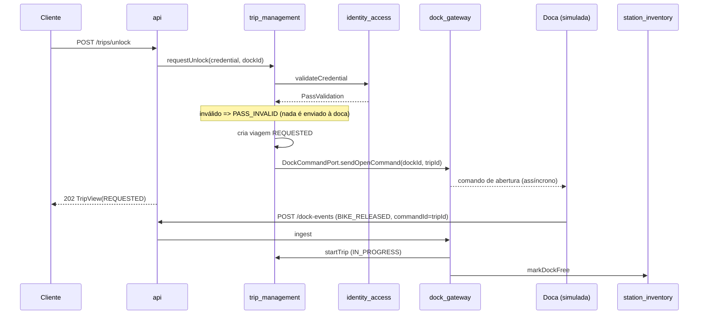
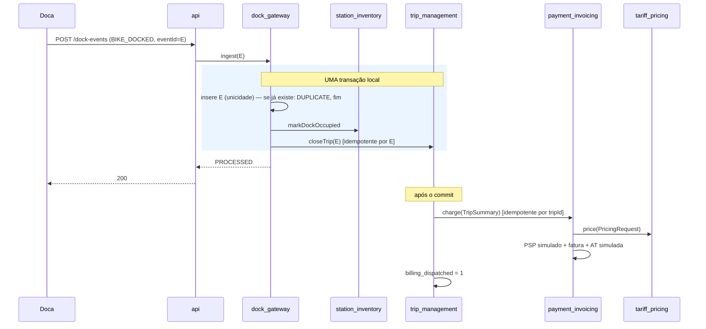

# Especificação de Arquitetura — Lisboa Pedala

## 0. Como usar este documento (instruções para a IA)

1. Lê o documento inteiro antes de escrever código. Implementa **um módulo de cada vez**, e só avanças quando `mvn verify` passar.
2. **Não cries** pacotes, módulos, tabelas ou endpoints que não estejam descritos aqui.


## 1. Módulos e Responsabilidades
* **Linguagem / Runtime:** Java 21
* **Particionamento:** Monólito Modular por Domínio (`src/main/java/pt/lisboapedala/`), ver ADR-001

| Módulo / Pacote | Responsabilidade Única (1 frase) | Pacote Java |
| :--- | :--- | :--- |
| `common` | Reúne tipos, exceções e DTOs imutáveis partilhados sem lógica de negócio. | `pt.lisboapedala.common` |
| `identity_access` | Gere a identidade, autenticação e validação do cartão Navegante e passe. | `pt.lisboapedala.identity_access` |
| `trip_management` | Orquestra a máquina de estados e o ciclo de vida da viagem. | `pt.lisboapedala.trip_management` |
| `dock_gateway` | Trata da resiliência, desduplicação e reenvio de eventos das docas offline. | `pt.lisboapedala.dock_gateway` |
| `station_inventory` | Mantém o estado de ocupação de estações e docas em tempo real. | `pt.lisboapedala.station_inventory` |
| `tariff_pricing` | Função pura sem estado para cálculo de valores de viagens por tarifário. | `pt.lisboapedala.tariff_pricing` |
| `payment_invoicing` | Processa transações financeiras e emite/comunica faturas fiscais à AT. | `pt.lisboapedala.payment_invoicing` |
| `fleet_health` | Ingestão de telemetria IoT (30s) e deteção automática de anomalias. | `pt.lisboapedala.fleet_health` |
| `maintenance_orders` | Gestão do fluxo e ciclo de vida das ordens de trabalho técnicas. | `pt.lisboapedala.maintenance_orders` |
| `redistribution_planning` | Otimização e sugestão de rotas de equilíbrio para as carrinhas. | `pt.lisboapedala.redistribution_planning` |
| `municipal_reporting` | Agregação de métricas mensais de utilização e CO₂ por freguesia. | `pt.lisboapedala.municipal_reporting` |
| `api` | Camada de entrada (CLI/REST) que encaminha pedidos e não tem lógica. | `pt.lisboapedala.api` |

---

## 2. Regras Allowed-to-Use (Dependências Verificáveis)
1. **Regra de Entrada:** NENHUM módulo de domínio pode importar ou depender do pacote `api`.
2. **Isolamento de Tipos:** NENHUM módulo pode aceder a modelos de persistência (entidades BD) de outro módulo.
3. **Módulo Comum:** O pacote `common` não pode importar nenhum outro módulo da aplicação.
4. **Acoplamento Tarifário:** `tariff_pricing` não pode importar nenhum módulo de domínio (apenas `common`).
5. **Relatórios:** `municipal_reporting` apenas realiza operações de leitura (*read-only*) sobre os dados de `trip_management` e `station_inventory`.
6. **Verificação Automatizada:** Estas regras são validadas pelas *fitness functions* em `ArchUnit` localizadas em `src/test/java/pt/lisboapedala/architecture/`.

---

## 3. Características Condutoras e Impacto no Código
* **Availability (Disponibilidade):** A lógica de fecho de viagem e devolução deve utilizar garantias de idempotência no `trip_management` baseadas no UUID do evento gerado pela doca.
* **On-Demand Elasticity (Elasticidade):** As operações de leitura de disponibilidade de docas/bicicletas (`station_inventory`) devem ser separadas das operações de escrita transacional de viagens.
* **Scalability (Escalabilidade):** As funções de cálculo em `tariff_pricing` devem ser puras e imutáveis para suportar adição dinâmica de regras de municípios vizinhos sem efeitos secundários.

---

## 4. Acoplamento Temporal e Unidades de Trabalho
* **Abertura de Viagem:** 1) Validação de passe em `identity_access` $\rightarrow$ 2) Emissão de sinal físico de abertura em `dock_gateway` $\rightarrow$ 3) Mudança de estado para em andamento em `trip_management`.
* **Devolução e Fecho:** A confirmação do encaixe na doca (`station_inventory`) e o cálculo de tempo de viagem (`trip_management`) têm de ser consolidados ANTES de invocar o débito e liquidação em `payment_invoicing`.

---

## 5. Convenções e Limitações para a IA
* **Proibido:** Não utilizar *imports* curinga (`import pt.lisboapedala.*`).
* **Proibido:** Não fazer *queries* SQL com *JOINs* entre tabelas de domínios diferentes.
* **Proibido:** Não criar dependências circulares entre componentes.
* **Obrigatório:** Todos os DTOs partilhados em `common` devem ser registos imutáveis (`record` em Java 21).
* **Obrigatório:** Boa práticas OOP (interfacing, extensão quando possível, mínimo de acoplamento entre módulos, separação de responsabilidades dos módulos, etc)
---

## 6. Mapeamento de ADRs por Componente
* **`trip_management` & `dock_gateway`:** ADR-002 e ADR-003 (Reestruturação).
* **Todos os Componentes:** ADR-001 (Monólito Modular por Domínio).

## 7 Concretizações

### 7.1 Stack e build

| Item | Decisão |
|---|---|
| Build | Maven (`pom.xml` único; não multi-módulo Maven — a modularidade é por pacotes) |
| Framework | Spring Boot 3.3+ (`spring-boot-starter-web`, `-jdbc`, `-validation`, `-actuator`) |
| Acesso a dados | Spring `JdbcClient`/`JdbcTemplate` + SQL à mão. **Sem JPA.** |
| BD | SQLite (`org.xerial:sqlite-jdbc`), ficheiro `data/lisboapedala.db`; WAL ativo; testes usam ficheiro temporário (`@TempDir`) |
| Esquema | Um ficheiro por módulo: `src/main/resources/db/<modulo>/schema.sql`, executados no arranque (`spring.sql.init.schema-locations=classpath*:db/*/schema.sql`) com `CREATE TABLE IF NOT EXISTS` |
| Testes | JUnit 5, AssertJ, Mockito (opcional), ArchUnit (`archunit-junit5`), `spring-boot-starter-test` |
| Serialização | Jackson; `Instant` em ISO-8601 (`2026-11-01T17:40:00Z`) |
| Agendamento | `@Scheduled` (jobs em `.internal` de cada módulo) |
| Logging | SLF4J; `correlationId` em MDC |

### 7.2 Estrutura do código 
```
.
├── pom.xml
├── ARCHITECTURE.md
├── IMPLEMENTATION_NOTES.md            # suposições feitas pela IA (uma linha cada)
├── data/                              # ficheiro SQLite
└── src
    ├── main
    │   ├── java/pt/lisboapedala
    │   │   ├── LisboaPedalaApplication.java
    │   │   ├── common/
    │   │   ├── identity_access/{query?,port?,internal,persistence}
    │   │   ├── trip_management/{query,port,internal,persistence}
    │   │   ├── dock_gateway/{internal,persistence}
    │   │   ├── station_inventory/{query,internal,persistence}
    │   │   ├── tariff_pricing/internal
    │   │   ├── payment_invoicing/{port,internal,persistence}
    │   │   ├── fleet_health/{internal,persistence}
    │   │   ├── maintenance_orders/{internal,persistence}
    │   │   ├── redistribution_planning/internal
    │   │   ├── municipal_reporting/internal
    │   │   └── api/{rest,cli,config}
    │   └── resources
    │       ├── application.yml
    │       └── db/<modulo>/schema.sql
    └── test/java/pt/lisboapedala
        ├── architecture/ArchitectureRulesTest.java
        ├── <modulo>/...               # testes unitários por módulo
        └── integration/{Us1...,Us2...,Us3...,Us4...}Test.java
```

### 7.3 API HTTP

Base: `/api/v1`. JSON. Datas em ISO-8601 UTC. Os *controllers* vivem em `api.rest`, só convertem DTO <-> chamada de serviço e **não têm lógica**. Autenticação por "mock" (aceita qualquer coisa).

**Erros:** `application/problem+json` (RFC 7807) com campos `type`, `title`, `status`, `detail` e a extensão `code` (= `ErrorCode`), mais `correlationId`. Mapeamento: `VALIDATION`→400, `NOT_FOUND`→404, `CONFLICT`→409, `PASS_INVALID`→403, `DOCK_UNAVAILABLE`→409, `PAYMENT_FAILED`→502, `TAX_SUBMISSION_FAILED`→502, `INTERNAL`→500. Um único `@RestControllerAdvice` em `api.rest`.

**Transversal:** filtro `CorrelationIdFilter` lê `X-Correlation-Id` (ou gera UUID), põe em MDC e devolve no cabeçalho de resposta.

| # | Método e caminho | Pedido | Resposta | Chama | Requisito |
|---|---|---|---|---|---|
| 1 | `POST /users` | `RegisterUserCommand` | `201` `UserProfile` | `IdentityService.register` | Req. 1 |
| 2 | `GET /users/{userId}` | — | `200` `UserProfile` | `IdentityService.getProfile` | Req. 1 |
| 3 | `PUT /users/{userId}/payment-method` | `{kind, token}` | `204` | `PaymentService.registerPaymentMethod` | US-1 |
| 4 | `POST /trips/unlock` | `{credential:{kind,value}, dockId}` | `202` `TripView` (`REQUESTED`) | `TripService.requestUnlock` | US-1 |
| 5 | `GET /trips/{tripId}` | — | `200` `TripView` | `TripService.getTrip` | US-1 |
| 6 | `GET /users/{userId}/trips?limit=20&offset=0` | — | `200` `[TripView]` | `TripService.history` | Req. 8a |
| 7 | `GET /users/{userId}/invoices?limit=20&offset=0` | — | `200` `[InvoiceView]` | `PaymentService.invoicesOf` | Req. 8b |
| 8 | `POST /dock-events` | `DockEvent` | `200` `IngestResult` | `DockEventIngestion.ingest` | US-3 |
| 9 | `POST /dock-events/batch` | `{events:[DockEvent]}` | `200` `[IngestResult]` | `DockEventIngestion.ingestBatch` | US-3 |
| 10 | `POST /telemetry` | `TelemetryReading` | `202` | `TelemetryIngestion.ingest` | US-2 |
| 11 | `GET /stations` | — | `200` `[StationOccupancy]` | `StationOccupancyQuery.findAll` | Req. 4 |
| 12 | `GET /stations/{stationId}` | — | `200` `StationOccupancy` / `404` | `StationOccupancyQuery.findByStation` | Req. 4 |
| 13 | `POST /maintenance-orders` | `{bikeId, faultType, description, reportedBy}` | `201` `MaintenanceOrderView` | `MaintenanceService.open` (`USER_REPORT`) | US-2 |
| 14 | `GET /maintenance-orders?status=OPEN` | — | `200` `[MaintenanceOrderView]` | `MaintenanceService.list` | US-2 |
| 15 | `POST /maintenance-orders/{id}/assign` | `{technicianId}` | `200` | `MaintenanceService.assign` | US-2 |
| 16 | `POST /maintenance-orders/{id}/start` | — | `200` | `MaintenanceService.start` | US-2 |
| 17 | `POST /maintenance-orders/{id}/complete` | `{notes}` | `200` | `MaintenanceService.complete` | US-2 |
| 18 | `GET /redistribution/routes?vans=2&vanCapacity=20` | — | `200` `[VanRoute]` | `RedistributionService.suggestRoutes` | Req. 6 |
| 19 | `GET /reports/monthly?month=2026-10` | — | `200` `MonthlyReport` | `MonthlyReportService.generate` | US-4 |
| 20 | `GET /actuator/health` | — | `200` | Spring Actuator | Supportability |

Notas:
* `POST /dock-events*` devolve **200 também para `DUPLICATE` e `UNMATCHED`** (a doca só descarta o evento do buffer local após 2xx).
* `POST /trips/unlock` devolve **202**: a viagem só passa a `IN_PROGRESS` quando chega o evento `BIKE_RELEASED`. O cliente consulta o estado com o endpoint 5.
* Os endpoints 8, 9 e 10 são os que recebem o pico de carga das docas; não podem depender de leituras pesadas.

### 7.4 Fluxos

#### 7.4.1 Abertura (US-1, parte 1)

Expiração: um *job* em `trip_management.internal` marca `EXPIRED` as viagens `REQUESTED` há mais de `lisboapedala.trip.unlock-timeout-seconds`.

#### 7.4.2 Devolução, fecho e cobrança (US-1, parte 2 e US-3)

**Outbox de cobrança:** um *job* em `trip_management.internal` (cada `lisboapedala.trip.billing-retry-interval-seconds`) procura viagens `CLOSED` com `billing_dispatched = 0` e volta a chamar `PaymentService.charge` (seguro: idempotente por `tripId`). Idem em `payment_invoicing` para cobranças `FAILED` (limite `lisboapedala.payment.max-attempts`) e faturas com `at_status = PENDING`.

**Reenvio (US-3):** a doca reenvia via `POST /dock-events/batch`. Cada evento duplicado devolve `DUPLICATE` e não produz nenhum efeito; um evento reenviado horas depois produz o **mesmo** valor cobrado, porque a duração usa `occurredAt`.

#### 7.4.3 Avaria automática e manual (US-2)
`POST /telemetry` → `TelemetryIngestion` → `fleet_health.TelemetryService.ingest` → (anomalia nova) → `MaintenanceService.open(AUTOMATIC)`. O reporte manual entra por `POST /maintenance-orders` (`USER_REPORT`). Se já existir ordem ativa para `(bikeId, faultType)`, **não** se cria outra.

#### 7.4.4 Relatório municipal (US-4)
`GET /reports/monthly` → `MonthlyReportService.generate` → `TripUsageQuery` (paginado) + `StationLocationQuery` → agregação em memória por freguesia.