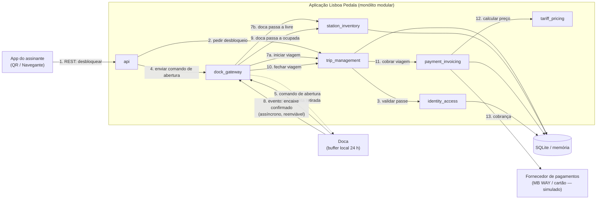

# Particionamento e vistas

## Particionamento de topo
Decisão: particionamento por domínio.

### Trade-offs

| | Por domínio (escolhido) | Técnico (rejeitado) |
|---|---|---|
| **Ganhos** | Uma mudança de negócio (ex.: novo tarifário para outra câmara) fica num só diretório. Permite atribuir componentes a pessoas (CODEOWNERS). Facilita extrair um componente (ex.: `dock_gateway`) mais tarde, se a elasticidade o exigir. | Estrutura familiar; o código encontra-se por tipo; cada camada tem uma preocupação técnica. |
| **Custos** | Código comum (autenticação, logging, tipos) tende a duplicar-se ou a ir para o `common`, que tem de ser mantido pequeno. Cada componente repete uma estrutura interna (modelo, serviço, repositório). | O fluxo desbloquear -> devolver -> cobrar atravessa todas as camadas: o domínio fica espalhado e o acoplamento global aumenta, sobretudo nos dados. Mudar um tarifário toca em várias camadas. |

## Vista de módulos

```
src/lisboa_pedala/
├── common/
├── identity_access/ # Contas de utilizador, passe anual, validação de QR e de cartão Navegante
├── trip_management/ # Ciclo de vida da viagem (desbloquear, devolver, fechar, histórico, etc)
├── dock_gateway/ # Receber eventos das docas, desduplicar e reenviar os eventos guardados offline, traduzir para chamadas de domínio
├── station_inventory/ # Estado de estações e docas (bicicletas e docas livres), dados para o mapa e dados abertos
├── tariff_pricing/ # Calcular o preço de uma viagem por tarifário (função pura, sem estado)    
├── payment_invoicing/ # Cobrar, emitir e guardar faturas, comunicar à AT
├── fleet_health/ # Receber telemetria das elétricas e detetar avarias
├── maintenance_orders/ # Abrir e acompanhar ordens de manutenção
├── redistribution_planning/ # Sugerir rotas às carrinhas a partir da ocupação das estações
├── municipal_reporting/ # Relatório mensal
└── api/
```

### Regras allowed-to-use

| Módulo | Pode usar |
|---|---|
| `api` | tudo |
| `dock_gateway` | `trip_management`, `station_inventory`, `fleet_health`, `common` |
| `trip_management` | `identity_access`, `station_inventory`, `payment_invoicing`, `common` |
| `payment_invoicing` | `tariff_pricing`, `common` |
| `fleet_health` | `maintenance_orders`, `common` |
| `redistribution_planning` | `station_inventory`, `common` |
| `municipal_reporting` | `trip_management` (read only), `station_inventory`, `common` |
| `identity_access`, `station_inventory`, `tariff_pricing`, `maintenance_orders` | `common` |
| `common` | nada |

Adicionalmente:
- Nada importa api
- Não há import loops
- `tariff_pricing` não importa nenhum componente de domínio
- `municipal_reporting` só lê
- Etc

### Vista de componentes e conectores de fluxo



Passos 1–7 = desbloquear; 8–10 = devolver; 11–13 = cobrar

Retângulo = componente; cilindro = armazenamento; seta contínua = chamada síncrona; seta tracejada = comando assíncrono; caixa grande = fronteira de implantação.

### Vista de alocação

| Elemento | Onde corre |
|---|---|
| App do utilizador | Telemóvel do utilizador | 
| Firmware docas | Docas | 
| Aplicação Lisboa Pedala (todos os componentes) | Servidores backend / cloud | 
| `dock_gateway` | Servidores backend / cloud | 
| Base de dados | Servidores backend / cloud | 
| Fornecedor de pagamentos e AT | Serviços externos |

#### Codeowners (WIP)
| Componente | Responsável |
|---|---|
| `user_account`, `dock_gateway` | Rodrigo |
| `payment_invoicing`, `tariff_pricing`, `identity_access` | Diogo |
| `station_inventory`, `fleet_health`, `maintenance_orders`, `redistribution_planning`, `municipal_reporting` | joe |
| `shared_kernel`, `api`, `tests/architecture/` | joe |