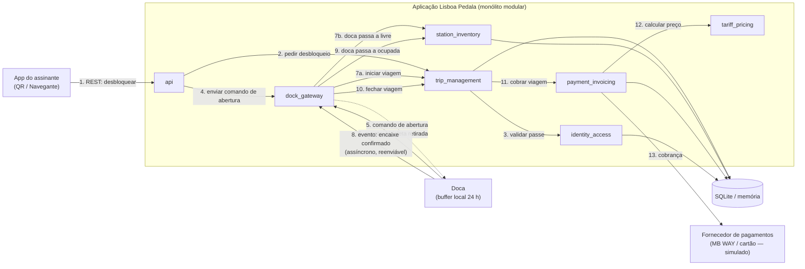

# Particionamento e vistas

## Particionamento de topo
Decisão: particionamento por domínio.

### Trade-offs

| Dimensão / Perspetiva | Por Domínio (Escolha do Grupo) | Técnico por Camadas (Rejeitado) |
| :--- | :--- | :--- |
| **Ganhos / Vantagens** | • **Mudanças Localizadas:** Alterações de negócio (ex.: novo tarifário para uma câmara vizinha) ficam contidas num só diretório (`tariff_pricing`).<br>• **Atribuição de Responsabilidade:** Permite atribuir a propriedade vertical dos componentes a cada elemento da equipa via `CODEOWNERS` sem conflitos frequentes de *merge* no Git.<br>• **Trilho para Microsserviços (*Evolvability*):** Facilita extrair um componente (ex.: `dock_gateway` por causa do débito IoT) para um serviço autónomo se a elasticidade o exigir no futuro.<br>• **Contexto Limpo para IA:** Ferramentas de IA conseguem ler e gerar o código de um único módulo mantendo a coerência com `ARCHITECTURE.md`.<br>• **Fitness Functions Eficientes:** Facilita a escrita de regras no **ArchUnit** para proibir importações indevidas entre pacotes de domínio. | • **Curva de Aprendizagem Baixa:** Estrutura altamente familiar e padrão na indústria (`controllers`, `services`, `repositories`).<br>• **Separação de Preocupações Técnicas:** Padrão limpo e isolado entre a camada de apresentação, lógica de negócio e acesso a dados.<br>• **Reutilização de Padrões Técnicos:** Fácil aplicação de padrões genéricos de persistência (ex.: configurações JPA/Hibernate, conectores) num só local. |
| **Custos / Desvantagens** | • **Gestão do Módulo `common`:** Risco de o pacote comum crescer descontroladamente; tem de ser mantido estritamente pequeno (apenas DTOs imutáveis, exceções e eventos).<br>• **Duplicação de Estrutura:** Cada módulo replica internamente a sua própria mini-camada (modelo, serviço, repositório).<br>• **Desafio de Consistência:** Exige disciplina da equipa de 6 devs para manter as mesmas convenções de código entre todos os diretórios. | • **Acoplamento Global e Alto Aumento de *Change Ripples*:** O fluxo transacional crítico (Desbloquear $\rightarrow$ Devolver $\rightarrow$ Cobrar) atravessa todas as camadas horizontais. Mudar uma regra de negócio num tarifário obriga a alterar ficheiros espalhados por todo o projeto.<br>• **Conflitos de Equipa (`CODEOWNERS` impraticável):** Todos os 6 programadores acabam a editar os mesmos pacotes genéricos (ex.: `services/`), gerando bloqueios e *merge conflicts*.<br>• **Violações Frequentes por IA:** Modelos de IA facilmente perdem o contexto da funcionalidade ao cruzar múltiplas pastas técnicas. |

## Vista de módulos

```
src/lisboa_pedala/
├── common/
├── identity_access/ # Contas de utilizador, passe anual, validação de QR e de cartão Navegante
├── trip_management/ # Ciclo de vida da viagem (desbloquear, devolver, fechar, histórico, etc)
├── dock_gateway/ # Receber eventos das docas, desduplicar e reenviar os eventos guardados offline, traduzir para chamadas de domínio
├── station_inventory/ # Estado de estações e docas (bicicletas e docas livres), dados para o mapa e dados abertos
├── tariff_pricing/ # Calcular o preço de uma viagem por tarifário (função pura, sem estado)    
├── payment_invoicing/ # Cobrar, emitir e guardar faturas, comunicar à AT
├── fleet_health/ # Receber telemetria das elétricas e detetar avarias
├── maintenance_orders/ # Abrir e acompanhar ordens de manutenção
├── redistribution_planning/ # Sugerir rotas às carrinhas a partir da ocupação das estações
├── municipal_reporting/ # Relatório mensal
└── api/
```

### Regras allowed-to-use

| Módulo | Pode usar |
|---|---|
| `api` | tudo |
| `dock_gateway` | `trip_management`, `station_inventory`, `fleet_health`, `common` |
| `trip_management` | `identity_access`, `station_inventory`, `payment_invoicing`, `common` |
| `payment_invoicing` | `tariff_pricing`, `common` |
| `fleet_health` | `maintenance_orders`, `common` |
| `redistribution_planning` | `station_inventory`, `common` |
| `municipal_reporting` | `trip_management` (read only), `station_inventory`, `common` |
| `identity_access`, `station_inventory`, `tariff_pricing`, `maintenance_orders` | `common` |
| `common` | nada |

Adicionalmente:
- Nada importa api
- Não há import loops
- `tariff_pricing` não importa nenhum componente de domínio
- `municipal_reporting` só lê
- Etc

### Vista de componentes e conectores de fluxo



Passos 1–7 = desbloquear; 8–10 = devolver; 11–13 = cobrar

Retângulo = componente; cilindro = armazenamento; seta contínua = chamada síncrona; seta tracejada = comando assíncrono; caixa grande = fronteira de implantação.

### Vista de alocação

| Elemento | Onde corre |
|---|---|
| App do utilizador | Telemóvel do utilizador | 
| Firmware docas | Docas | 
| Aplicação Lisboa Pedala (todos os componentes) | Servidores backend / cloud | 
| `dock_gateway` | Servidores backend / cloud | 
| Base de dados | Servidores backend / cloud | 
| Fornecedor de pagamentos e AT | Serviços externos |

#### Codeowners
| Componente | Responsável |
|---|---|
| `trip_management`, `dock_gateway`, `station_inventory`, `identity_access` | Diogo |
| `payment_invoicing`, `tariff_pricing`, `fleet_health`, `maintenance_orders`, `redistribution_planning`, `municipal_reporting` | Rodrigo |
| `common`, `api` | Ambos |